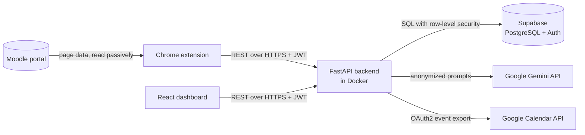

# Smart Student Task Hub

> **Status:** 🚧 Phase A–B (initiation and backlog) is complete. Implementation starts in Sprint 1. There is no application code in the repository yet.

**Smart Student Task Hub** (Azure DevOps project: *Academic Task Manager & AI Assistant*) brings every assignment, quiz and deadline from a student's Moodle courses into one dashboard.

A Chrome extension quietly collects tasks while the student browses Moodle. A FastAPI backend stores them in Supabase. A React dashboard shows them in date order with countdown timers and flags deadlines the lecturer has changed. An AI assistant built on Google Gemini answers questions about the student's tasks, creates reminders, and drafts formal grade appeals. Personal details are removed on the server before anything is sent to the AI.

Developed by the **MASHAB** team as the Software Engineering course project (SE-2026).

## Table of contents

- [The problem](#the-problem)
- [Key features](#key-features)
- [Tech stack](#tech-stack)
- [Architecture at a glance](#architecture-at-a-glance)
- [Project management](#project-management)
- [Repository structure](#repository-structure)
- [Getting started](#getting-started)
- [Development workflow](#development-workflow)
- [Documentation](#documentation)
- [Team](#team)
- [License](#license)

## The problem

Students juggle many courses whose assignments are spread across several Moodle sites. Lecturers move deadlines or post announcements without any central notification. Moodle has no single date-ordered view and no countdowns. The result is missed deadlines and unnecessary stress.

## Key features

| Area | What it does |
|---|---|
| **Automatic Moodle sync** | A Chrome extension (Manifest V3) reads assignments from Moodle pages in the background, using the student's own logged-in session. No Moodle password is ever sent to or stored on our server. |
| **Unified dashboard** | All tasks from every course in date order, with live countdown timers, summary widgets (due today / this week / overdue), search, course filters and a semester calendar view. Loads in under 3 seconds. |
| **"Recently Modified" alerts** | When a lecturer changes or postpones a deadline, the task gets a red badge until the student has seen it. |
| **AI assistant** | A chat that answers questions about the student's real tasks and creates reminders from free text such as *"Add a quiz for Thursday at 20:00"* (using Gemini function calling). |
| **AI Appeal Assistant** | Turns the grader's comments and the student's answer into a formal appeal letter in under 5 seconds, ready to edit and copy. |
| **Google Calendar export** | Export one deadline or all upcoming deadlines to Google Calendar, kept in sync when Moodle changes. |
| **Privacy by design** | Strict data separation between users (row-level security), and removal of names, ID numbers and emails before any request to the AI. |

**Scope:** the system only **reads** from Moodle. It never submits assignments or changes grades.

## Tech stack

| Layer | Technology |
|---|---|
| Data collection | Chrome Extension, Manifest V3 (service worker plus content scripts that read Moodle pages) |
| Frontend | React |
| Backend | Python, FastAPI |
| Database and auth | Supabase: PostgreSQL with row-level security, Supabase Auth with JWT |
| AI | Google AI Studio / Gemini API (system instructions, function calling) |
| Integrations | Google Calendar API |
| Infrastructure | Docker / Docker Compose, GitHub Actions for CI/CD |
| Testing | Pytest, Playwright / Selenium |

The reasons for these choices are in [ADR 0002](docs/adr/0002-technology-stack.md).

## Architecture at a glance



The full description is in [docs/architecture.md](docs/architecture.md).

## Project management

Planning and tracking happen in **Azure DevOps** (organization `mogrossm`), using the **Agile** process template and working in Scrum-style sprints. GitHub holds the source code and the documentation.

- **Backlog:** 5 epics, 20 features, 80 user stories and their tasks, organized by the five subsystems below.
- **Sprints:** implementation is planned as three one-week sprints. Dates will be set when implementation starts.
- **Wiki:** the Project Initiation Document, the context diagram, user scenarios and the AI Studio prototype live in the Azure DevOps wiki.
- **Linking:** put `AB#<id>` in a commit message or pull request description to link it to an Azure Boards work item, for example `AB#183`. This needs the [Azure Boards app for GitHub](https://learn.microsoft.com/azure/devops/boards/github/).

| Epic | Subsystem | Lead |
|---|---|---|
| [Epic 1](https://dev.azure.com/mogrossm/_workitems/edit/464) | Infrastructure, Database & Authentication | Elkana Drin |
| [Epic 2](https://dev.azure.com/mogrossm/_workitems/edit/8) | Moodle Scraping & Extension Core | Shoham Kaminetzky |
| [Epic 3](https://dev.azure.com/mogrossm/_workitems/edit/9) | Backend Sync & Moodle Integration | Benaya Birnbaum |
| [Epic 4](https://dev.azure.com/mogrossm/_workitems/edit/10) | User Interface, Dashboard & Time Management | Moshe Grossman (with Shoham Kaminetzky) |
| [Epic 5](https://dev.azure.com/mogrossm/_workitems/edit/6) | AI Layer & Academic Automation | Moshe Grossman |

Prototype: [academic-task-manager.ai.studio](https://academic-task-manager.ai.studio/)

## Repository structure

Current:

```
.
├── .github/                # Issue and PR templates, code owners
├── backend/                # FastAPI server (Docker): sync logic, AI gateway
│   ├── app/main.py
│   ├── Dockerfile
│   └── requirements.txt
├── frontend/               # Dashboard (placeholder Node server; React comes in Epic 4)
│   ├── Dockerfile
│   ├── package.json
│   └── server.js
├── docs/                   # Project documentation
│   ├── adr/                # Architecture Decision Records
│   ├── architecture.md     # System overview
│   └── requirements.md     # Functional and non-functional requirements
├── .env.example            # Template for local environment variables
├── docker-compose.yml      # Local development environment
├── .editorconfig
├── .gitattributes
├── .gitignore
├── CODE_OF_CONDUCT.md
├── CONTRIBUTING.md         # How to contribute (branches, commits, PRs)
├── SECURITY.md
└── README.md
```

Planned folders, to be added as each subsystem starts:

| Folder | Contents | Epic |
|---|---|---|
| `extension/` | Chrome extension (Manifest V3) | 2 |
| `supabase/` | Database migrations and row-level security policies | 1 |
| `tests/` | Integration and end-to-end tests (Playwright / Selenium) | all |

## Getting started

### Prerequisites

- Git
- Docker Desktop (includes Docker Compose)
- Google Chrome, for loading the extension (once it exists)

### Run locally

```bash
git clone https://github.com/mos26613/SE-2026.git
cd SE-2026
cp .env.example .env        # then fill in your own Supabase values; never commit .env
docker compose up --build
```

| Service | URL |
|---|---|
| Backend API | http://localhost:8000 |
| API documentation (Swagger) | http://localhost:8000/docs |
| Frontend | http://localhost:3000 |

Stop everything with `docker compose down`. The backend reloads automatically when you edit files in `backend/`.

## Development workflow

In short: pick a work item in Azure Boards, branch from `main`, make small focused commits that reference `AB#<id>`, open a pull request, get a review, merge. The full rules are in [CONTRIBUTING.md](CONTRIBUTING.md).

## Documentation

| Document | Purpose |
|---|---|
| [docs/requirements.md](docs/requirements.md) | What the system must do: features, user scenarios, NFRs |
| [docs/architecture.md](docs/architecture.md) | How the system is structured: components, data, security |
| [docs/adr/](docs/adr/) | Why key technical decisions were made |

## Team

**MASHAB Systems**

| Name | Role |
|---|---|
| Elkana Drin | Team Lead & Architecture: Supabase Auth, row-level security, DevOps |
| Benaya Birnbaum | Backend & Database Lead: FastAPI, sync algorithms, caching |
| Moshe Grossman | AI Integration & Frontend Lead: Gemini API, PII anonymization, function calling, Appeal Assistant; lead for the React dashboard |
| Shoham Kaminetzky | Chrome Extension Lead: Manifest V3 extension, background sync, Moodle page scraping, session/cookie handling; supports the React dashboard |

## License

_TODO: The team still has to choose a license (for example MIT) and add a `LICENSE` file. Until then, all rights are reserved by the authors._
