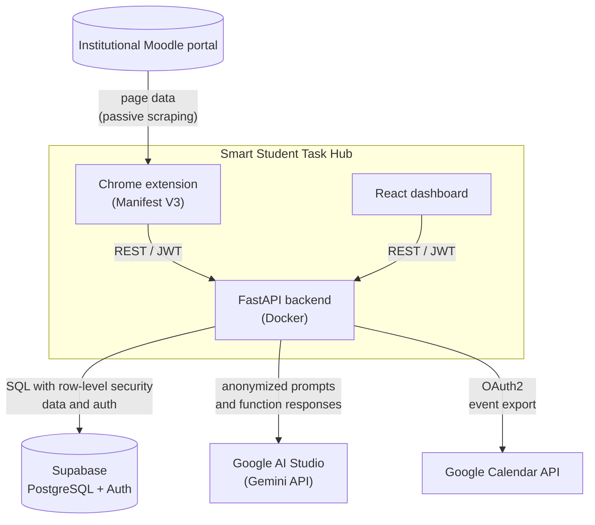
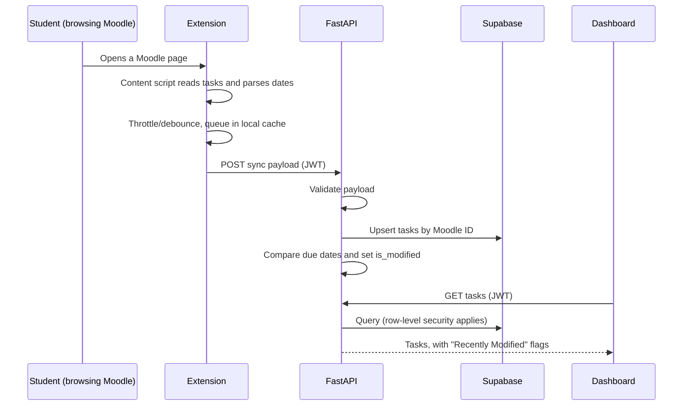
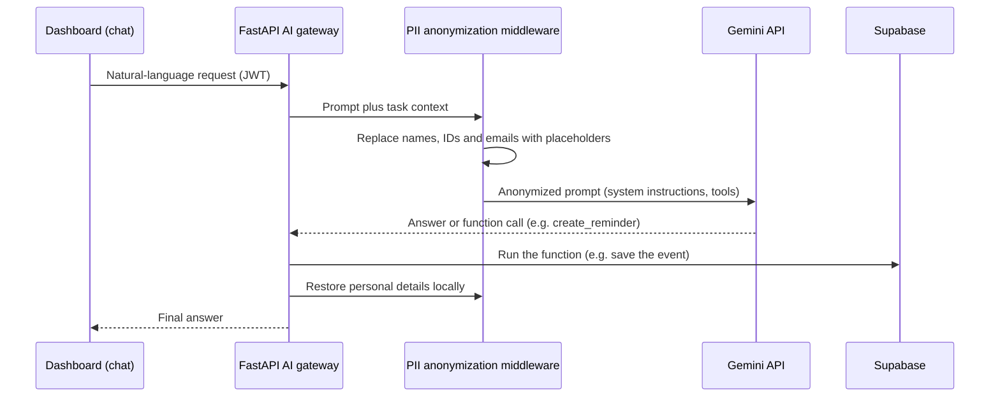
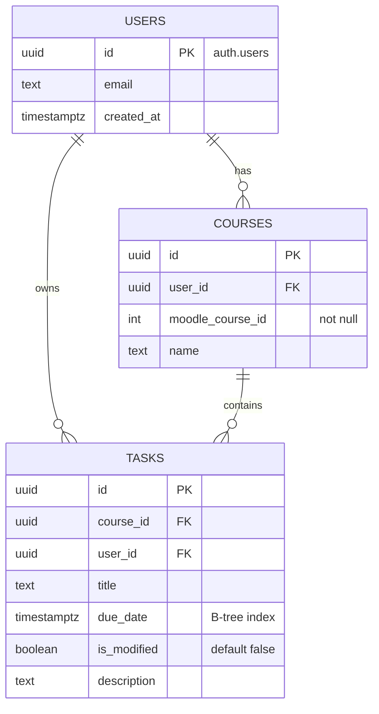

# Architecture

> **Status:** design (Phase A). Based on the Project Initiation Document and the context diagram in the Azure DevOps wiki. Update it as the implementation makes things concrete, and record significant decisions as [ADRs](adr/).

## 1. Overview

Smart Student Task Hub uses a **client-server architecture made of containerized services**:

1. A **Chrome extension** collects assignment data from Moodle pages in the student's browser.
2. A **FastAPI backend** in Docker validates, stores and processes that data, and is the only component that talks to the AI and Google Calendar.
3. **Supabase** provides authentication (JWT) and a PostgreSQL database protected by row-level security.
4. A **React dashboard** shows the student's tasks and hosts the AI chat and the Appeal Assistant.
5. **Google Gemini** receives only anonymized data.

## 2. Context diagram

The original diagram is on the wiki page *Project Overview → Architecture & Context Diagram*.

## 3. Subsystems

| # | Subsystem (epic) | Responsibilities | Technology |
|---|---|---|---|
| 1 | **Infrastructure, Database & Auth** | Registration and sign-in, JWT, PostgreSQL schema and migrations, row-level security policies, secrets, CORS and rate limiting, Docker images, CI/CD | Supabase, PostgreSQL, Docker, GitHub Actions |
| 2 | **Moodle Extension Core** | Manifest V3 extension, background service worker, content scripts that read Moodle pages, date parsing, throttled sync with a local cache and queue, session/cookie monitoring, popup UI | Chrome Extensions API, JavaScript/TypeScript |
| 3 | **Backend Sync Engine** | Sync endpoint, payload validation, upsert by Moodle ID, "Recently Modified" change detection, conflict handling, caching, sync logging, calendar export | Python, FastAPI, Pydantic, Supabase client |
| 4 | **React Dashboard & UI** | Date-ordered task list, countdowns, summary widgets, search and filters, semester calendar, Google Calendar connection and export UI | React |
| 5 | **AI Layer** | AI gateway with quotas and error handling, versioned system prompts, PII anonymization middleware, chat agent with function calling, Appeal Assistant | Gemini API (Google AI Studio) |

## 4. Main flows

### 4.1 Silent sync (scenarios 2 and 5)

Target: the dashboard is up to date within about **3 seconds**.

### 4.2 AI request (scenario 3)

## 5. Data model

Logical entities (to be finalized in the Supabase migrations):

**Indexes.** Every task query is limited to one student, so each composite index starts with `user_id`: `(user_id, due_date)` serves the dashboard's "soonest deadline first" query, `(user_id, moodle_course_id)` serves the course link, and the unique `(user_id, moodle_id)` serves the sync upsert. The full list, the `EXPLAIN` results and the 100 ms target are in [performance/indexing.md](performance/indexing.md) (US 1.2.2).

## 6. Security and privacy

- **Row-level security** on every user table: `auth.uid() = user_id`. Policies, privileges and tests are in [security/rls.md](security/rls.md) (US 1.3.1).
- **JWT** from Supabase Auth on every request from the extension and the dashboard.
- **No Moodle passwords** are stored or sent; the extension uses the student's existing session on the client side.
- **PII anonymization** on the server is mandatory before any Gemini request, and personal details are restored only locally ([ADR 0003](adr/0003-anonymize-pii-before-ai.md)).
- **Secrets** (Supabase keys, Gemini key, Google OAuth credentials) come only from environment variables or GitHub Actions secrets and are never committed.
- **CORS and rate limiting** on the API; encrypted local storage in the extension.

## 7. Communication

REST over HTTPS with JSON payloads. The extension and the dashboard talk only to the FastAPI backend. Only the backend talks to Gemini and Google Calendar.

## 8. Deployment and environments

| Environment | Description |
|---|---|
| Local development | Docker Compose: FastAPI container, with a Supabase project or local Supabase |
| CI | GitHub Actions: lint, tests and Docker build on every pull request |
| Production | Multi-stage Docker image for the backend; Supabase cloud (free tier) |

_Hosting for the backend and dashboard is still to be decided. Record the choice in an ADR._

## 9. Testing strategy

| Level | Tools | Focus |
|---|---|---|
| Unit | Pytest (backend), a JS test runner (extension, React) | Parsing, upsert and change detection, anonymization |
| Integration | Pytest with a test Supabase database | API plus database plus row-level security |
| End-to-end | Playwright / Selenium | Extension → backend → dashboard flows |
| Non-functional | Load and timing checks | Dashboard < 3 s, auth middleware < 50 ms, queries < 100 ms, appeal letter < 5 s |

## 10. Open questions

- Hosting for the backend and dashboard.
- Language for the extension and frontend (JavaScript or TypeScript).
- Extension packaging and distribution (unpacked vs Chrome Web Store).
