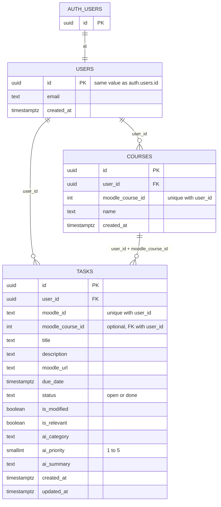

# Database schema

The core PostgreSQL schema in Supabase (User Story 1.2.1, AB#206). It is created by
[`001_initial_schema.sql`](../../supabase/migrations/001_initial_schema.sql). Later migrations
add security rules and indexes; this page covers the three core tables.

## Entity relationship diagram

`auth.users` belongs to Supabase Auth. We never write to it directly.

## Tables

| Table | Purpose | Uniqueness |
|---|---|---|
| `users` | Student profile, one row per Supabase Auth user. Filled automatically by the `on_auth_user_created` trigger. | `id` |
| `courses` | A Moodle course of one student. | `(user_id, moodle_course_id)` |
| `tasks` | An assignment collected from Moodle. | `(user_id, moodle_id)` |

## Delete behavior

All foreign keys use `ON DELETE CASCADE`:

- Deleting a user in Supabase Auth deletes their `users` row, and with it their courses and tasks.
- Deleting a course deletes the tasks that point to it.

## Decisions

**Course name and course link.** The course name is stored once in `courses.name`. A task points to
its course with `moodle_course_id`, and the foreign key is `(user_id, moodle_course_id)`, so a task
can only point to a course of the same student. The backend reads the name through this link
(`backend/app/db.py`). An earlier version of the User Story mentioned `course_name` and a
`course_id` column in `tasks`; the schema above replaces them.

**Tasks without a course.** `moodle_course_id` may be empty. Postgres does not check a composite foreign
key when one of its columns is empty, so a task without a course is allowed.

**`is_modified`.** It means that the task details changed on Moodle after we first saved them, for
example the lecturer moved the due date. The dashboard uses it for the "Recently Modified" badge. The sync
sets it (User Story 3.3.1) when a task comes back with a different title, description or due date.
Nothing clears it yet.

**One row per assignment.** The `(user_id, moodle_id)` uniqueness lets the sync update an existing task
instead of creating a duplicate.

## Check the schema

[`supabase/tests/schema_validation.sql`](../../supabase/tests/schema_validation.sql) is a script that
checks the foreign keys, the cascade deletes and the uniqueness rules. It changes nothing: it runs
inside a transaction that is rolled back at the end.

1. Open the Supabase project, then **SQL Editor**.
2. Paste the script and run it.
3. A successful run ends with the message `schema validation passed`. Any failed check stops the
   script with an error that names the check.
